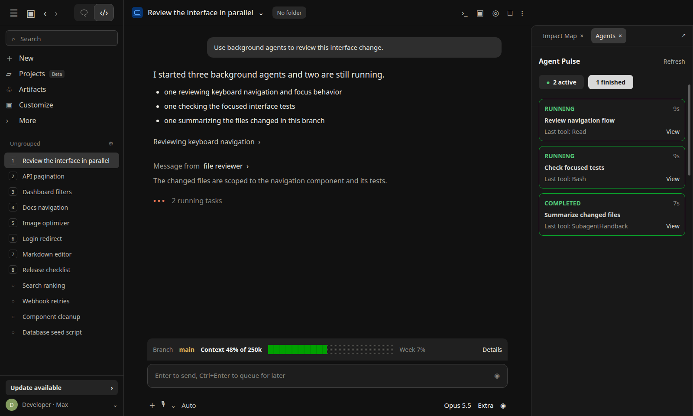

# Agent Pulse

Agent Pulse opens an `Agents` pane when the first subagent starts in the current session.



## Install

```bash
claude plugin install agent-pulse@traversy-mods
```

Restart the session or enter `/reload-plugins` after installation.

## What it shows

Each agent has a compact card with:

- Current status
- Agent name or task description
- Elapsed time since the mod first observed it
- Current tool while one is running
- Most recent tool after it finishes

The pane does not open when a session has no subagents. It also does not take keyboard focus when it opens automatically. Enter `/agent-pulse` whenever you want to open it manually or bring it back after closing it. Claude's built-in `/agents` command remains unchanged.

Select `View` on an agent card to replace the list with a compact detail view. The detail view shows the agent type, status, elapsed time, parent agent when present, and up to eight recent transcript messages. Select `Back` to return to the full list.

Agent Pulse keeps finished agents in the pane for the rest of the current session, even when Claude Code no longer includes them in its live agent list. The history resets when the mod reloads or a new session starts.

Possible states are:

- `PENDING` before work begins
- `RUNNING` while the agent is working
- `WAITING` when it is waiting on another action
- `IDLE` when a teammate is available for more work
- `COMPLETED` after a successful result
- `FAILED` after an error or refusal
- `KILLED` after an interrupted run

Agent Pulse uses only Claude Code's agent, session, clock, command, and interface APIs. It does not call a model, start a process, read project files, make a network request, or save agent transcripts outside the current session.

Claude Code may deny transcript access for an agent running in another process, a remote workflow agent, or an agent whose saved transcript is no longer available. The card still shows any status and activity that Claude Code reports, and the detail view explains when its transcript cannot be read.

## Test Agent Pulse

1. Install and load `agent-pulse`.
2. Enter `/agent-pulse` and confirm that the empty state says there are no subagents in the session.
3. Ask Claude to use an Explore subagent to inspect a small part of the current project.
4. Confirm that the `Agents` pane opens without taking focus.
5. Watch the card update with the agent status, elapsed time, and current or last tool.
6. Select `View` and confirm that the recent prompt, response, and tool names appear.
7. Select `Back` to return to the agent list.
8. Repeat the same check in a terminal session and a local session in the desktop Code tab.

## Source

[`hooks/register.tsx`](./hooks/register.tsx)

[Back to the mod index](../README.md#included-mods)
