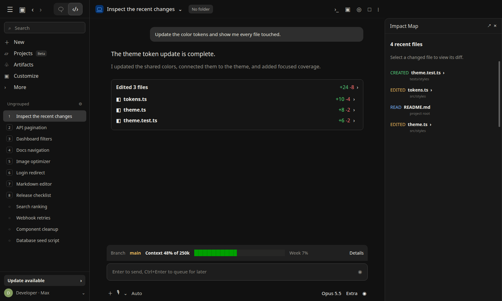

# Impact Map

Impact Map opens a compact session dashboard for the files Claude reads and changes.



## Install

```bash
claude plugin install impact-map@traversy-mods
```

Restart the session or enter `/reload-plugins` after installation.

## How it works

The summary shows how many files were changed or read. When Claude Code provides diff statistics, it also shows the session's total added and removed lines.

Use `All` to see every touched file or `Changed` to focus on edits and new files. Changed files sit in one bordered region, while read activity stays quieter underneath. Entries use project-relative folders, and the most recently touched files appear first.

Each file has a compact marker:

- `R` when Claude reads a file
- `~` when Claude edits or updates a file
- `+` when Claude creates a file

The pane keeps the 14 most recent unique file paths. Reading or changing the same file again moves it to the newest position without losing its stronger changed or created status.

Changed files include their latest added and removed line counts when available. Selecting one opens a Diff pane with Claude Code's native unified-diff highlighting. Tracked files use the current working-tree diff against `HEAD`. Untracked files are shown as newly added files.

The Diff pane reflects the file's current Git state, not a private history of only Claude's edits. If you or another tool changed the same file, those changes appear too. Read-only files are not clickable because they have no change to display.

Claude Code has one docked pane area. If another pane mod is also open, the panes appear as tabs in that area rather than side by side.

## Test Impact Map

1. Install and load `impact-map`.
2. Ask Claude to read files from two folders, edit one file, and create another.
3. Confirm that the summary, folder groups, and added and removed counts update.
4. Select `Changed` and confirm that read-only files disappear.
5. Select an edited file and confirm that its highlighted diff opens in a new pane tab.
6. If the Impact Map pane is closed, enter `/impact-map` to reopen it.

## Source

[`hooks/register.tsx`](./hooks/register.tsx)

[Back to the mod index](../README.md#included-mods)
