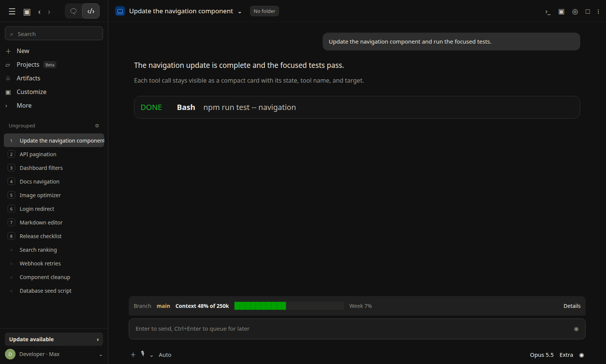

# Tool Cards

Tool Cards replaces Claude Code's standard tool-use row with a bordered card that emphasizes the current state, tool name, and target.



## Install

```bash
claude plugin install tool-cards@traversy-mods
```

Restart the session or enter `/reload-plugins` after installation.

## States

- `RUNNING`
- `DONE`
- `FAILED`
- `STOPPED`

For file tools, the card displays the file path. For Bash, it displays the command. It also handles tools that expose a `path` or `pattern` field.

## Test Tool Cards

1. Install and load `tool-cards`.
2. Ask Claude to read a file.
3. Watch the card change from `RUNNING` to `DONE`.
4. Ask Claude to run a command that fails if you want to see the `FAILED` state.

The green `DONE` label is part of this mod. Disable Tool Cards from `/plugin` to return to Claude Code's normal tool rows.

## Source

[`hooks/register.tsx`](./hooks/register.tsx)

[Back to the mod index](../README.md#included-mods)
