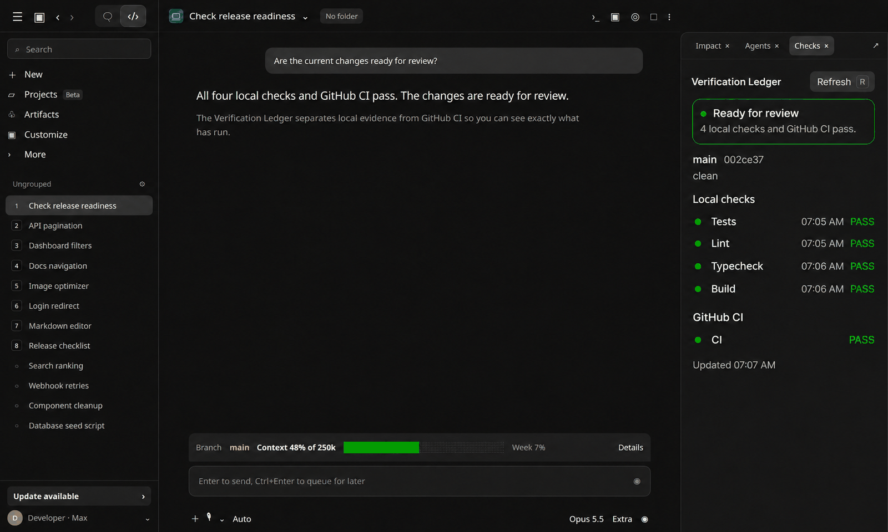

# Verification Ledger

Verification Ledger opens a Checks pane that turns local verification commands, current Git state, and GitHub Actions runs into a live release-readiness dashboard.



## Install

```bash
claude plugin install verification-ledger@traversy-mods
```

Restart the session or enter `/reload-plugins` after installation.

## Usage

The pane opens automatically after Claude finishes the first recognized verification command in a session. It opens without taking keyboard focus.

The status card gives the most important result first: ready for review, a failed check, stale evidence that needs a rerun, CI still running, or no checks yet. Local checks stay in a fixed order with their time and current state aligned for quick scanning. Git and GitHub CI remain visible as supporting evidence rather than competing summaries.

Open it manually or bring it back after closing it with:

```text
/checks
```

When another pane mod is open, Claude Code places them in tabs within the same docked pane area.

## Recognized local commands

The ledger recognizes common commands in these categories:

- Verify: `npm run verify`, `pnpm verify`, `yarn verify`, `bun verify`, and `./scripts/verify`
- Tests: package test scripts, Vitest, Jest, Pytest, `cargo test`, and `go test`
- Lint: package lint scripts, ESLint, Biome, Ruff, golangci-lint, and Cargo Clippy
- Typecheck: package typecheck scripts, `tsc --noEmit`, Mypy, and Pyright
- Build: package build scripts, `cargo build`, and `go build`

The command must be run by Claude through its Bash tool. A command run manually in a separate terminal is not a Claude Code event, so the mod cannot observe it.

## Pass, fail, and stale results

Verification Ledger stores the latest result in each category for the current session.

- `PASS` means the recognized command completed successfully.
- `FAIL` means it returned an error.
- `STALE` means files, the current commit, or the recorded session revision changed after the check ran.

Local results reset when the mod reloads or a new session starts. The ledger is a live session display, not a permanent audit database.

## GitHub Actions support

Remote checks require the GitHub CLI:

```bash
gh --version
gh auth status
```

If needed, authenticate it:

```bash
gh auth login
```

While the Checks pane is open, the mod runs this read-only query for the current commit every 15 seconds:

```bash
gh run list --commit <commit-sha> --limit 8 --json name,status,conclusion,url,headSha,workflowName
```

The pane displays workflow links and the states `RUNNING`, `PASS`, `FAIL`, or `SKIPPED`. It also shows a toast when a previously running workflow passes or fails.

If `gh` is missing, not authenticated, or the repository is not hosted on GitHub, the remote section reports that GitHub CI is unavailable. Local checks and Git state still work.

## Change the polling interval

Open [`hooks/config.ts`](./hooks/config.ts):

```ts
export const CI_POLL_INTERVAL_MS = 15_000
export const MAX_CI_RUNS = 8
```

Change the values to control how often the open pane refreshes and how many workflow runs it displays.

## Test Verification Ledger

1. Install and load `verification-ledger` in a Git repository.
2. Ask Claude to run the project's test command.
3. Confirm that the Checks pane opens without taking keyboard focus.
4. Confirm that `Tests` appears with `PASS` or `FAIL`.
5. Ask Claude to edit a file.
6. Reopen or refresh `/checks` and confirm that the status card asks for a rerun and the earlier result is `STALE`.
7. Push a commit with GitHub Actions configured.
8. Leave the pane open and watch the workflow move from `RUNNING` to its final state. When local checks and GitHub CI pass for a clean commit, the card should say `Ready for review`.

## Source

[`hooks/register.tsx`](./hooks/register.tsx)

[Back to the mod index](../README.md#included-mods)
