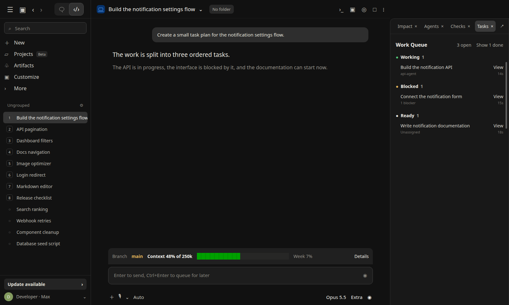

# Work Queue

Work Queue gives Claude portable task tools and turns the `Tasks` pane into a live progress board for the current session. It works in both local Desktop sessions and the terminal without depending on Claude's built-in task-list tools.



## Install

```bash
claude plugin install work-queue@traversy-mods
```

Restart the session or enter `/reload-plugins` after installation.

## Progress board

- `Working now` gives the active task a focused card and shows its live action
- `Blocked` for pending tasks with unfinished dependencies
- `Ready` for pending tasks that can start
- `Done` for completed tasks

The progress rail shows completed work at a glance. The focused task uses its `activeForm` as a live verb, such as `Building the API`, and shows how many other tasks it unlocks. Blocked tasks name the unfinished dependency instead of showing only a count. Each task also shows its owner when one is assigned and how long it has been in its current state.

Select `Details` to see the full description, owner, creation and update times, tasks that block it, and tasks that depend on it. Dependencies are clickable, so you can move through the work graph without leaving the pane. Completed tasks leave the active list automatically. Select `Show N done` to review them and `Hide N done` to collapse them again.

The pane does not open in an empty session and does not take keyboard focus when it opens automatically. Enter `/work-queue` to open it manually or bring it back after closing it.

## Model-callable tools

The mod registers four tools:

- `task_create` adds a task and returns its queue id
- `task_update` changes its status, owner, description, or blockers
- `task_list` reads the current queue before Claude plans or updates work
- `task_clear` removes every task when you ask Claude to clear or reset the Work Queue

Dependency updates keep both sides of each relationship in sync. `task_update` rejects self-dependencies, missing blockers, and dependency cycles without changing the existing graph.

A short session instruction tells Claude to use these tools for substantive work with several concrete steps, or whenever you explicitly ask for a task list. It also tells Claude not to create tasks for simple questions or one-step actions. The queue reflects real tool calls. It does not guess tasks from ordinary chat text or execute tasks itself.

For compatibility, Work Queue still observes Claude's built-in `TaskCreate`, `TaskUpdate`, `TaskList`, and `TaskGet` tools when a runtime provides them. It also observes task-created and task-completed lifecycle events. These native Claude tasks are labeled as read-only in `task_list`; update them with Claude's native `TaskUpdate` tool. Work Queue never reports a local update as successful when the native task was not changed.

Task history lives only in memory for the current session. Reloading the mod or starting a new session clears the pane. The mod does not call a model, start a process, read project files, make a network request, or persist task data.

Claude Code does not deliver the session instruction or classic task lifecycle events to user-installed plugins when an organization manages the installation. The Work Queue tools remain available, but you may need to ask Claude explicitly to use them.

## Test Work Queue

1. Install and load `work-queue`.
2. Enter `/work-queue` and confirm that the empty state says there are no tasks in the session.
3. Ask Claude: `Create a three-step task plan in Work Queue where the interface task depends on the API task.`
4. Ask Claude to start the API task.
5. Confirm that the progress rail updates, the active task appears under `Working now`, the dependent task names the API task under `Blocked`, and the remaining task appears under `Ready`.
6. Select `Details` on the blocked task and confirm that the API task appears under `Blocked by`.
7. Complete the API task and confirm that it leaves the active list while the dependent task moves to `Ready`.
8. Select `Show 1 done` and confirm that the completed API task appears under `Done`.
9. Ask Claude to clear the Work Queue and confirm that the pane returns to its empty state.
10. Repeat the same check in a terminal session and a local session in the Desktop Code tab.

## Source

[`hooks/register.tsx`](./hooks/register.tsx)

[Back to the mod index](../README.md#included-mods)
